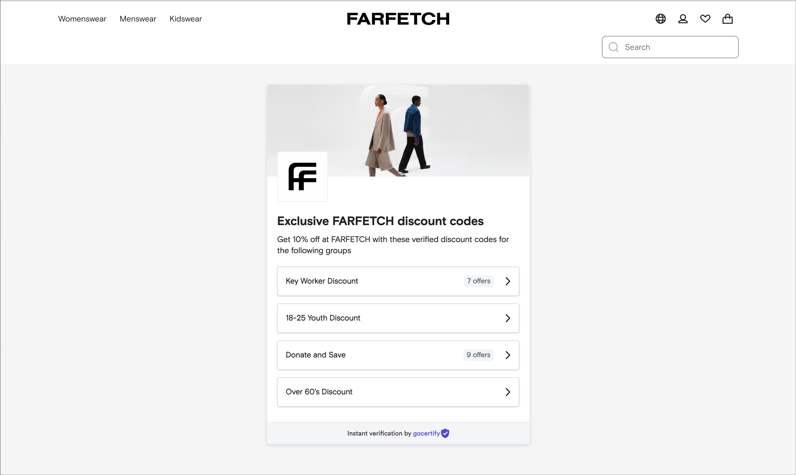

import LandingPageSteps from '/snippets/landing-page-integration-steps.mdx';


Landing pages are a powerful tool for converting key communities and boosting your SEO.


## Create Campaign landing pages
<Tip>
  Best practice is to create dedicated landing pages for your high-priority communities, like Key Workers and Students.

  To increase SEO traffic ensure that the group name and “discount” is mentioned.

  - **Clear Page Slug:** i.e `student`, `key-worker`, `senior`, `youth`, `disability`
  - **Meta title and H1:** _company_ student discount
  - **Meta description:** We know that a little help goes a long way when you're a student. Verify your student status and you can get 10% off.
  - **Relevant Copy:** ~300 words talking about the campaign and why it's important to your audience.

</Tip>

<Frame caption="Farfetch campaign pages drive evergreen revenue growth YoY.">
  
  
</Frame>

Adding a campaign specific landing page is simple, we recommend getting started with the following steps:


<LandingPageSteps />

 

## Choose the campaigns a landing page shows

Go to **Promotion > Landing Pages** in your dashboard to create a landing page that shows a set of campaigns you choose, in the order you choose. Copy its **Embed code**, which includes an `identifier`:

```html iFrame with identifier
  <gocertify-iframe identifier="i-abc123"></gocertify-iframe>
```

Once a shopper enters a landing page, every link and the back button keep them inside it.

### Default landing page

Every brand has a **Default** landing page. It styles every step of your reward flow: your hosted page, iFrame, campaign pages, verification and codes. Until you save it, it uses your current brand settings (title, description, custom CSS and iFrame parent CSS). After you save it, it owns them, and edits to those settings elsewhere no longer apply to your reward flow. The code `<gocertify-iframe></gocertify-iframe>` with no attributes shows the Default landing page.
