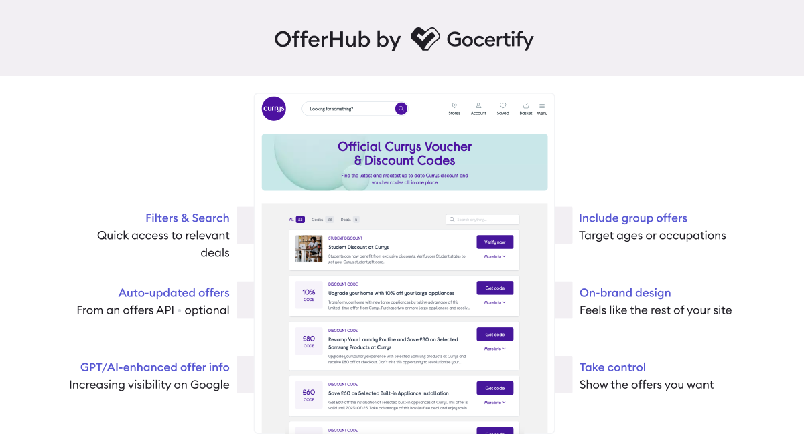

import OfferHubIntegrationSteps from '/snippets/offerHub-integration-steps.mdx';

OfferHub is a centralised location for all your discounts and offers. It's a great way to showcase all your discounts in one place and drive traffic to your site.

<Tip>
  Best practice is to create a dedicated multi-offers page to showcase all your discounts in one place. To increase SEO traffic ensure the terms “discount codes”, “offers” and “coupon” (if wanting to rank in the the USA) are mentioned:

  - **Clear Page Slug:** i.e `discounts`
  - **Meta title and H1:** Official _Brand_ Discount Codes and Offers
  - **Meta description:** Did you just search for a _brand_ discount code? That's an intelligent move - you're obviously a savvy shopper. This is the official discount code page for _brand_ and you won't find a better discount elsewhere.
  - **Relevant Copy:** ~300 words talking about the rewards you offer and why they're important to your audience.
  - **FAQs:** Answer common questions about your rewards.


</Tip>

  <Frame caption="OfferHub is a powerful showcase of all your offers and discounts in one place. ">
    
    
  </Frame>

To add OfferHub to your site, follow these steps:

<OfferHubIntegrationSteps />

## Hosted page

Prefer not to build a page? Every brand has a ready-made OfferHub page hosted by Gocertify. Link to it from your menu, footer or emails:

```text Hosted OfferHub page
https://secure.gocertify.me/at/your-brand/offerhub
```

## Manage your OfferHubs

Go to **Promotion > Offer Hub** in your dashboard to manage your OfferHubs.

- **Default OfferHub.** The OfferHub shown by the code above, and by your hosted page, is your default. Until you save it, it uses your current brand settings.
- **Choose the campaigns.** Pick the campaigns each OfferHub shows and their order, or add a row such as "All campaigns" that updates itself as your campaigns change.
- **Hosted page text.** Set the tagline, title and description shown above the OfferHub on your hosted page. They don't appear when you embed.
- **Styling.** Each OfferHub has its own styling.

### Use more than one OfferHub

Create as many OfferHubs as you need, for example one for students and one for everyone. Copy the **Embed code** from the OfferHub's page. For any OfferHub that isn't the default it includes an `identifier`:

```html OfferHub with identifier
  <gocertify-hub identifier="o-abc123"></gocertify-hub>
```

You can put several on the same page, each with its own identifier.

### Draft and live

A new OfferHub starts as **Draft**. A draft is not shown to shoppers: an embedded draft stays empty and its hosted page is not found. Switch on **Live** when it is ready. Your default OfferHub is always live.
